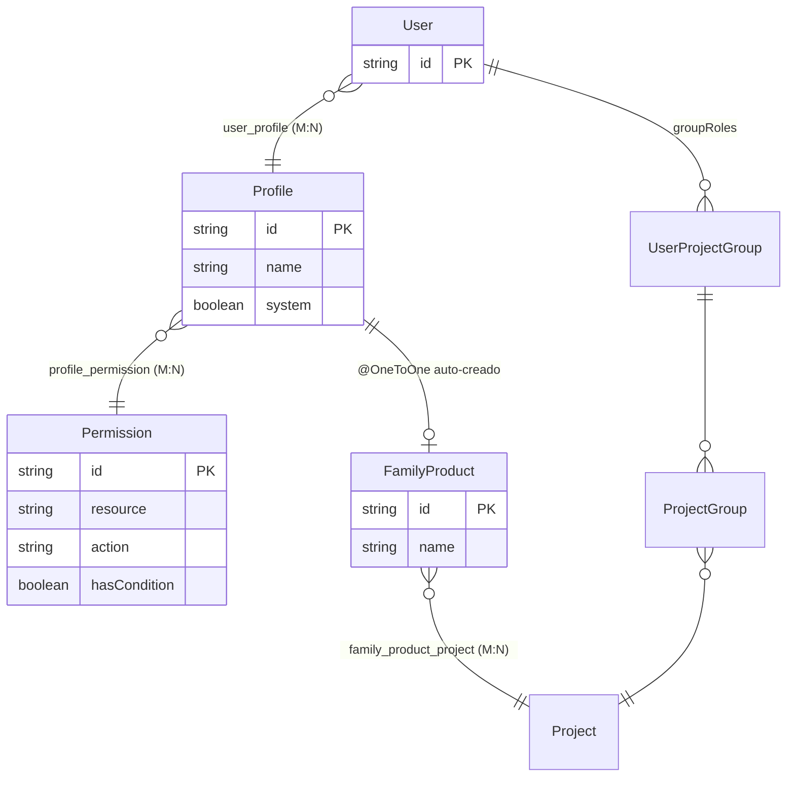
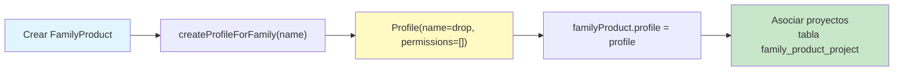
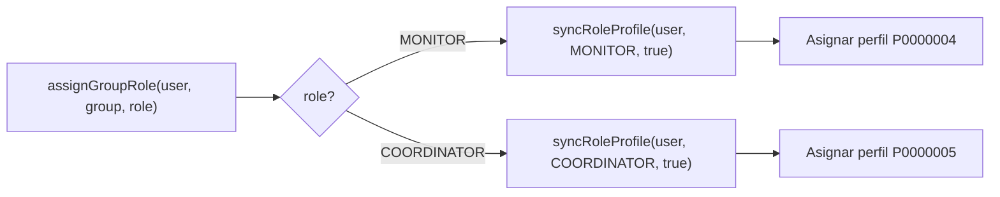
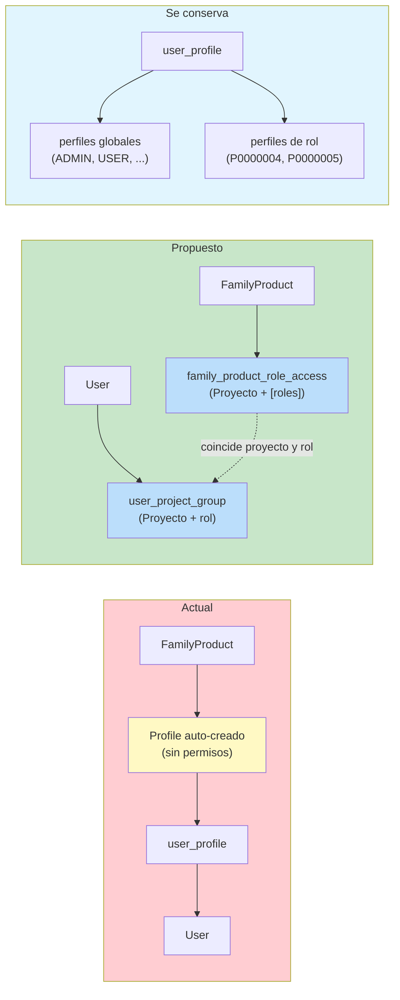
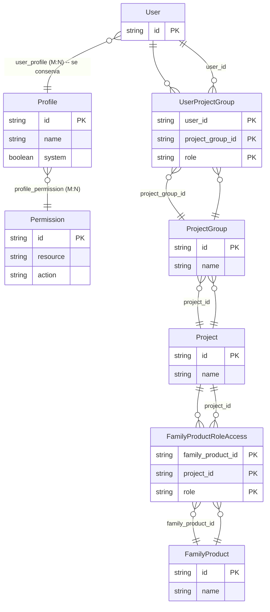
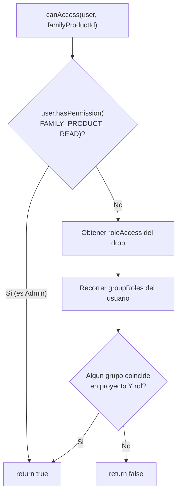
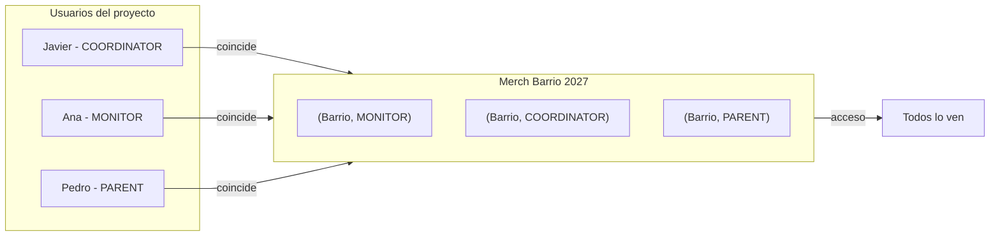
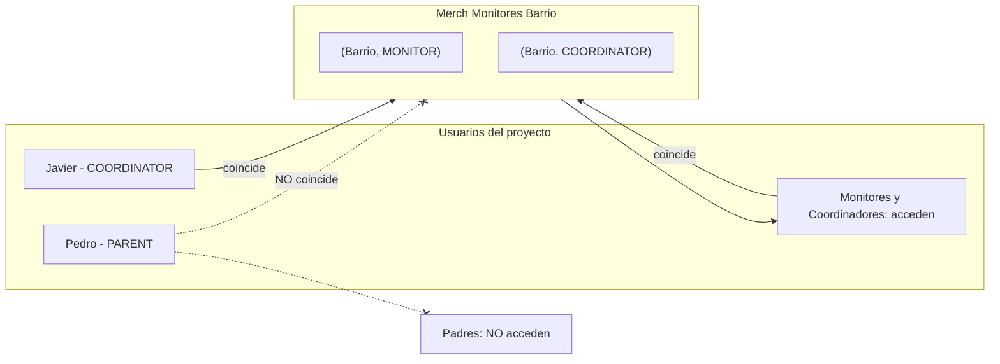
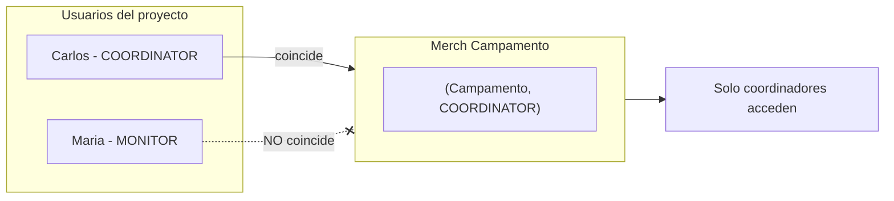

# Propuesta: Unificar permisos por Proyecto + Rol (eliminar perfiles auto-generados)

## Sistema actual

### Modelo de datos actual (Backend Java)



### Enums actuales

**`UserProjectGroupRole.java`** (en el paquete `enums`):
```java
public enum UserProjectGroupRole {
    MONITOR,
    COORDINATOR
}
```
Solo 2 roles. No existe `PARENT`.

### Perfiles predefinidos (seed Liquibase)

| ID | Nombre | System | Rol asociado |
|---|---|---|---|
| `ADMIN` | Administrator | [OK] | --- |
| `USER` | Standard User | [OK] | --- |
| `PRJ_MGR1` | Project Manager | [OK] | --- |
| `MERCH_MG` | Merch Manager | [OK] | --- |
| `P0000004` | **Monitor** | [OK] | MONITOR |
| `P0000005` | **Coordinador** | [OK] | COORDINATOR |

Los perfiles `P0000004` y `P0000005` son perfiles de "rol" --- se asignan/desasignan **automáticamente** cuando un usuario obtiene o pierde un rol en un grupo de proyecto.

Estos perfiles de rol **se conservan** en el nuevo modelo porque:
- Se sincronizan automáticamente desde `user_project_group`
- Son útiles para checks `@PreAuthorize` globales (ej. "es monitor de algún proyecto")
- Cubren permisos que no son de un proyecto concreto

### Cómo funciona el acceso a Merch (FamilyProduct)

**Creación de un drop** (`FamilyProductService.createFamilyProduct()`):



**Listado de drops visibles** (`FamilyProductSpecifications` --- en el repositorio `spec/`):
```java
// Filtra por los perfiles que tiene el usuario
hasAnyProfile(profileIds)
```
El usuario ve un drop si tiene el perfil correspondiente (el que se auto-creó para ese drop).

**Invitación a un drop**: se asigna el perfil del drop al usuario (tabla `user_profile`).

**Sincronización automática** (`UserService`):



### Frontend

**`LINKS_MAP`** en `links.ts` --- 20 links, protegidos por `{ obj, action }`:
```ts
{ name: "merchFamilies", need: { obj: "family_product", action: "read" } }
{ name: "projects",      need: { obj: "project",      action: "read" } }
// etc.
```

**Filtro en Dashboard** `_layout.tsx`:
```ts
LINKS_MAP.filter(link =>
  link.need == null || user.permissions.some(p =>
    p.obj === link.need!.obj && p.actions.includes(link.need!.action)
  )
)
```

**`RequirePermission.tsx`**: componente que envuelve secciones, renderiza solo si el usuario tiene el permiso.

**`AuthContext.hasPermission()`**: busca en `user.permissions: { obj, actions[] }[]`.

**Tipos frontend** (`userType.ts`):
```ts
UserGroupRole: { groupId, groupName, projectId, projectName, role: 'MONITOR' | 'COORDINATOR' }
```
El frontend YA conoce los roles de proyecto del usuario (`groupRoles`), pero no los usa para control de acceso a Merch.

---

## Problemas del modelo actual

1. **1 perfil por drop de Merch** -> se crea un perfil nuevo en BD cada vez que se crea un drop
2. **Perfiles sin permisos reales** --- estos perfiles auto-creados tienen `permissions = Set.of()`, solo existen como "etiqueta de pertenencia"
3. **Dos mecanismos paralelos para acceso a Merch**:
   - `user_profile` (perfiles de drop auto-creados) -> controla acceso a Merch
   - `user_project_group` (proyecto + rol) -> controla pertenencia a equipos
   Ambos apuntan a la misma realidad (quién pertenece a qué proyecto) pero usan tablas distintas
4. **Los roles de proyecto ya existen** (`MONITOR`, `COORDINATOR`) pero **no se usan** para control de acceso a Merch --- se necesita un mecanismo extra de perfiles
5. **Añadir un nuevo rol** (ej. `PARENT`) requiere: añadir al enum, crear perfil P0000006 en seed, sincronizarlo en UserService, actualizar queries en repos --- disperso en 5+ archivos
6. **Los ingresos del extracto bancario** (cuotas de socios) no tienen representación en el sistema de permisos --- un "socio que paga cuota" no es ni MONITOR ni COORDINATOR, no encaja en el modelo actual
7. **Escalabilidad**: cada nuevo tipo de contenido restringido (documentos, formularios, álbumes) requeriría repetir el patrón de perfiles auto-creados

---

## Propuesta de unificación

### Principio

> Los permisos se basan en **Proyecto + Rol**, no en perfiles auto-creados.
> Un usuario ya tiene roles (`MONITOR`, `COORDINATOR`, `PARENT`) en proyectos vía `user_project_group`.
> Cualquier entidad (Merch, actividad, documento) declara directamente **qué proyecto(s) y qué rol(es)** pueden acceder.

### Nuevo modelo



### Cambios en base de datos

**Nueva tabla**: `family_product_role_access`

```sql
CREATE TABLE family_product_role_access (
    family_product_id VARCHAR(8) NOT NULL REFERENCES family_product(id),
    project_id         VARCHAR(8) NOT NULL REFERENCES project(id),
    role               VARCHAR(20) NOT NULL,  -- MONITOR | COORDINATOR | PARENT
    PRIMARY KEY (family_product_id, project_id, role)
);
```

**A eliminar** (en migración separada, solo lo del Merch):
- Columna `profile_id` de `family_product` (FK + unique) --- el perfil auto-creado ya no se necesita
- Tabla `family_product_project` (se unifica en `family_product_role_access`)
- Perfiles auto-creados para drops de Merch (los que tengan `system=false` y solo referenciados desde `family_product`)

**Se conserva**:
- Tabla `user_profile` --- sigue siendo el mecanismo para asignar perfiles globales (ADMIN, MERCH_MG, PRJ_MGR1, etc.) y los perfiles de rol (P0000004 Monitor, P0000005 Coordinador)
- Tabla `profile` --- igual, para perfiles de sistema y globales
- Tabla `profile_permission` --- igual
- Tabla `permission` --- igual

### Nuevo modelo de datos (propuesto)



### Nuevo enum de roles

```java
// UserProjectGroupRole.java
public enum UserProjectGroupRole {
    MONITOR,
    COORDINATOR,
    PARENT  // <- NUEVO
}
```

### Modelo Java (`FamilyProduct.java`)

**Antes:**
```java
@OneToOne
private Profile profile;                    // perfil auto-creado
@ManyToMany
private Set<Project> projects;              // family_product_project
```

**Después:**
```java
@ElementCollection
@CollectionTable(name = "family_product_role_access",
    joinColumns = @JoinColumn(name = "family_product_id"))
private Set<FamilyProductRoleAccess> roleAccess;  // proyecto + roles
```

Nuevo embeddable:
```java
@Embeddable
public class FamilyProductRoleAccess {
    private String projectId;
    @Enumerated(EnumType.STRING)
    private UserProjectGroupRole role;
}
```

### Lógica de control de acceso

**Backend** --- nuevo método en `FamilyProductService`:



```java
public boolean canAccess(User user, String familyProductId) {
    // 1. ADMIN siempre puede (profile con permiso FAMILY_PRODUCT:READ)
    if (user.hasPermission(FAMILY_PRODUCT, READ)) return true;

    // 2. Obtener los accesos del drop
    Set<FamilyProductRoleAccess> required = familyProduct.getRoleAccess();

    // 3. Verificar si el usuario coincide en proyecto Y rol
    return user.getGroupRoles().stream().anyMatch(gr ->
        required.contains(new FamilyProductRoleAccess(
            gr.getProjectGroup().getProject().getId(),
            gr.getRole()
        ))
    );
}
```

**En listado** --- `FamilyProductSpecifications` cambia de `hasAnyProfile(profileIds)` a:

```java
// Opción A: Query JPQL que cruza family_product_role_access con user_project_group
@Query("SELECT fp FROM FamilyProduct fp " +
       "WHERE EXISTS (SELECT 1 FROM FamilyProductRoleAccess ra " +
       "              WHERE ra.familyProduct = fp " +
       "              AND ra.projectId IN :projectIds " +
       "              AND ra.role IN :roles)")
List<FamilyProduct> findAccessibleFamilyProducts(
    @Param("projectIds") Set<String> projectIds,
    @Param("roles") Set<UserProjectGroupRole> roles
);
```

**Opción B (simplificada, sin nueva tabla intermedia):**
Mantener la tabla `family_product_project` como está y añadir solo `family_product_role_access` para los roles. Pero la opción A unifica todo.

### Interfaz de usuario (creación/edición de drop)

**Actual:** selector simple de proyectos (MultiSelect de proyectos).

**Propuesto:** árbol de proyectos con checkboxes de roles por proyecto:

```
.--------------------------------------.
| Acceso al Merch                      |
|                                       |
| Proyectos y roles autorizados:        |
|                                       |
| [x] Barrio                              |
|   |-- [x] Coordinador                   |
|   |-- [x] Monitor                       |
|   '-- [x] Padre                         |
|                                       |
| [ ] Campamento                          |
|   |-- [ ] Coordinador                   |
|   |-- [ ] Monitor                       |
|   '-- [ ] Padre                         |
|                                       |
| [x] Grupo Joven                         |
|   |-- [x] Coordinador                   |
|   |-- [ ] Monitor                       |
|   '-- [ ] Padre                         |
'--------------------------------------'
```

### Gestión de miembros

**Actual:** se asigna un perfil específico a un usuario (ej. "Merch Barrio 2027").
**Propuesto:** se asigna un **rol en un proyecto** al usuario (ej. "Padre del proyecto Barrio").

- Invitaciones individuales: email + proyecto + rol
- Invitaciones masivas: CSV/lote con proyecto + rol por defecto
- Al registrarse, el usuario ya tiene su proyecto+rol -> acceso automático a todos los Merch que permitan ese rol

### Ejemplos de uso

**Ejemplo 1 --- Merch general del proyecto Barrio**



**Ejemplo 2 --- Merch solo para monitores de Barrio**



**Ejemplo 3 --- Merch de Campamento solo para coordinadores**



---

## Plan de migración

| Fase | Descripción | Archivos |
|---|---|---|
| **1** | Añadir `PARENT` al enum `UserProjectGroupRole` | `enums/UserProjectGroupRole.java` |
| **2** | Migración Liquibase: crear tabla `family_product_role_access` | `db/changelog/changes/91-permissions-role-access.xml` |
| **3** | Migración de datos: por cada `family_product_project` existente, insertar filas en `family_product_role_access` con roles MONITOR + COORDINATOR (retrocompatible) | misma migración |
| **4** | Crear embeddable `FamilyProductRoleAccess` + actualizar `FamilyProduct.java` | `model/FamilyProductRoleAccess.java`, `model/FamilyProduct.java` |
| **5** | Actualizar `FamilyProductService`: nuevo método `canAccess()`, modificar `createFamilyProduct()` para no crear perfil automático | `service/FamilyProductService.java` |
| **6** | Actualizar `FamilyProductSpecifications`: nuevo filtro por proyecto+rol en vez de `hasAnyProfile` | `repository/spec/FamilyProductSpecifications.java` |
| **7** | Actualizar frontend: formulario de drops con árbol proyecto+roles | `app/routes/dashboard/drops/` |
| **8** | Migración de limpieza (posterior): eliminar columna `profile_id` de `family_product`, tabla `family_product_project`, y perfiles de drop huérfanos (`system=false` sin referencia a perfiles de rol) | nueva migración Liquibase |
| **9** | Eliminar creación de perfiles automáticos en `FamilyProductService.createFamilyProduct()` (la lógica `createProfileForFamily`) | `service/FamilyProductService.java` |
| **10** | Verificar que `user_profile` solo se usa para perfiles globales y de rol, no para drops | tests + revisión manual |

### Archivos a modificar (resumen)

**Backend (~16 archivos):**

| Archivo | Cambio |
|---|---|
| `enums/UserProjectGroupRole.java` | Añadir `PARENT` |
| `model/FamilyProductRoleAccess.java` | **NUEVO** --- embeddable |
| `model/FamilyProduct.java` | Sustituir `@OneToOne Profile` + `@ManyToMany Project` por `@ElementCollection Set<FamilyProductRoleAccess>` |
| `service/FamilyProductService.java` | Eliminar `createProfileForFamily()`, nueva lógica de creación con roles, nuevo `canAccess()` |
| `service/PermissionCheckService.java` | Posible nuevo check por proyecto+rol |
| `repository/spec/FamilyProductSpecifications.java` | Nuevo filtro por proyecto+rol |
| `repository/FamilyProductRepository.java` | Nueva query `findAccessibleFamilyProducts()` |
| `service/UserService.java` | Ya no necesita sincronizar perfiles de drops (los de rol MONITOR/COORDINATOR se conservan) |
| `controller/FamilyProductController.java` | Endpoints de creación/edición aceptan `roleAccess` en vez de `projectIds` |
| `controller/AdminUserController.java` | Ajustar endpoints de grupo si se añade soporte PARENT |
| `controller/PublicController.java` | Ajustar lógica de visibilidad de drops |
| `db/changelog/changes/91-permissions-role-access.xml` | **NUEVA** migración |
| `db/changelog/master.xml` | Incluir nueva migración |
| `db/changelog/changes/92-cleanup-legacy-permissions.xml` | **NUEVA** migración (fase 8) |

**Frontend (~7 archivos):**

| Archivo | Cambio |
|---|---|
| `app/types/userType.ts` | Añadir `PARENT` al tipo `UserGroupRole.role` |
| `app/context/AuthContext.tsx` | Nuevo helper `hasRoleInProject(projectId, role)` |
| `app/routes/dashboard/drops/create.tsx` | Nuevo formulario con árbol proyecto+roles |
| `app/routes/dashboard/drops/edit.tsx` | Mismo formulario para edición |
| `app/routes/dashboard/drops/index.tsx` | (si hay filtros) |
| `app/components/drops/DropForm.tsx` | **NUEVO** o refactor del formulario existente |
| `app/services/dropService.ts` | Actualizar tipos de creación/edición |

---

## Ventajas respecto al actual

| Aspecto | Actual | Propuesto |
|---|---|---|
| Perfiles auto-creados | 1 por drop de Merch | 0 |
| Mecanismos de acceso a Merch | `user_profile` (perfil del drop) | `family_product_role_access` (proyecto+rol) |
| `user_profile` | Se usaba para TODO (global + drops) | Solo para perfiles globales y de rol |
| Nuevo rol (ej. Cocinero) | Añadir enum + perfil seed + sync en UserService + queries en repos | Solo añadir al enum |
| Nuevo tipo de contenido restringido | Crear perfil auto-generado + M:N user_<tipo> | Reutilizar proyecto+rol existente |
| Coherencia organización | Un padre de Barrio no puede ver Merch aunque esté en el proyecto | Si el Merch permite PARENT, puede |
| Ingresos (cuotas socios) | No hay modelo para representarlos | PARENT es el rol natural para "socio pagador" |
| Mantenimiento admin (Merch) | Gestionar perfiles de drop + asignaciones manuales | Gestionar solo proyecto+rol |
| Conciliación bancaria | 367/429 movimientos sin match (solo gastos) | Los ingresos pueden mapearse a socios con rol PARENT |
