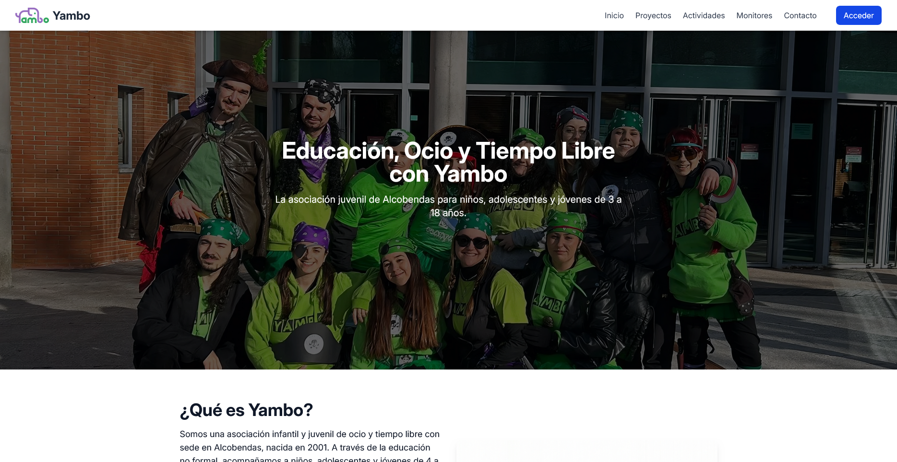
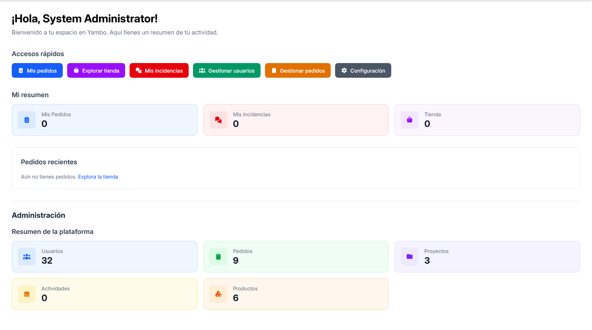
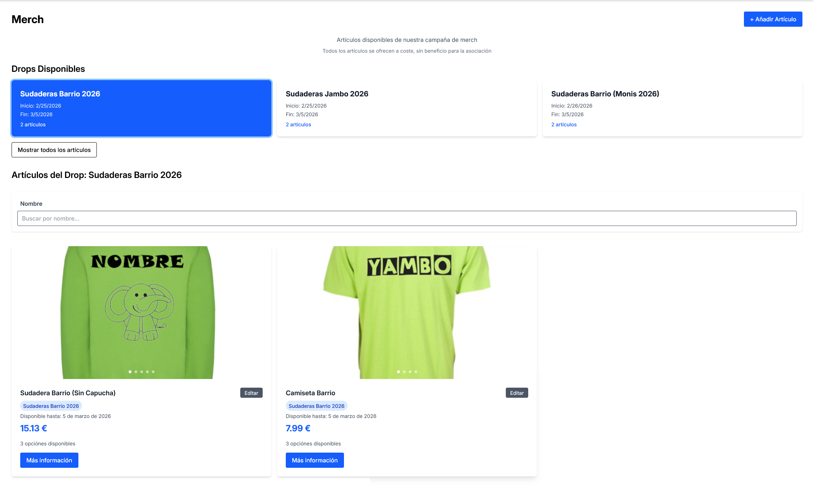
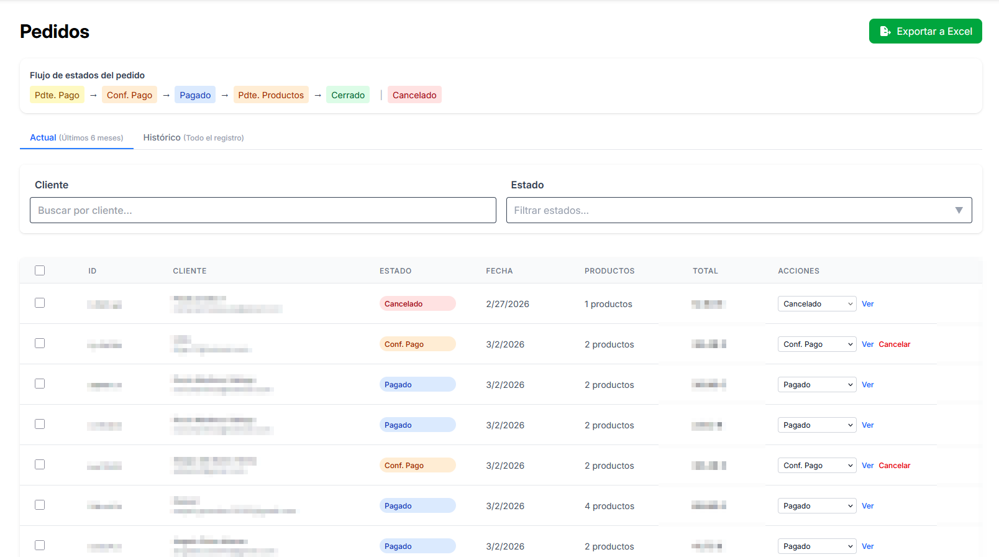
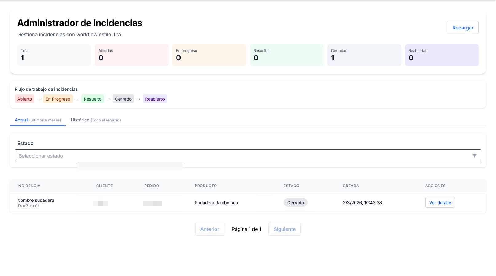
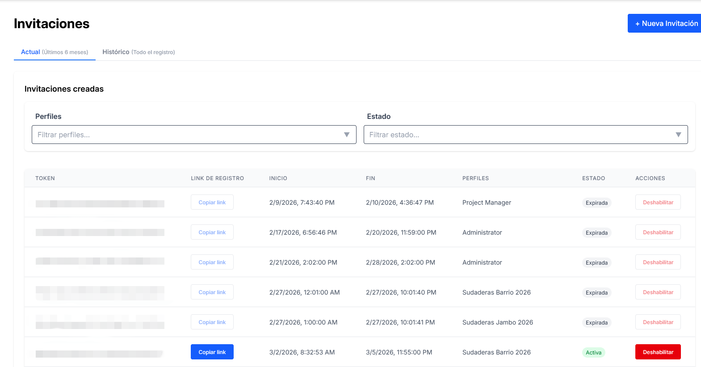
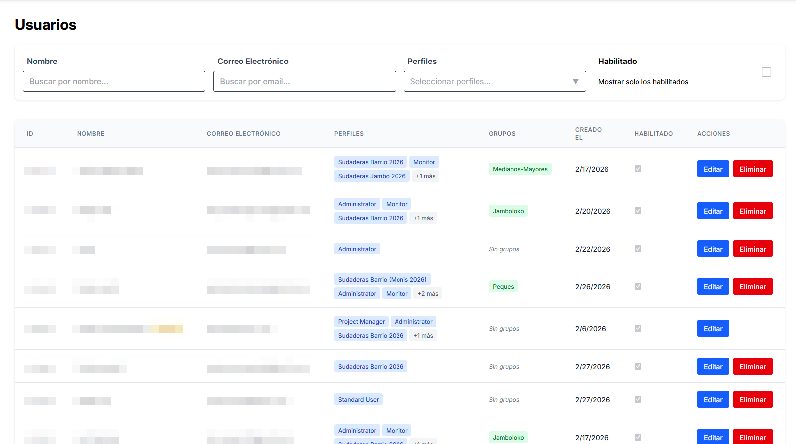
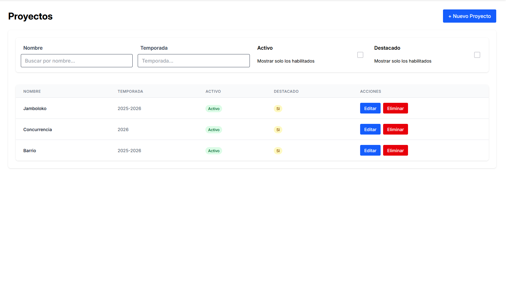
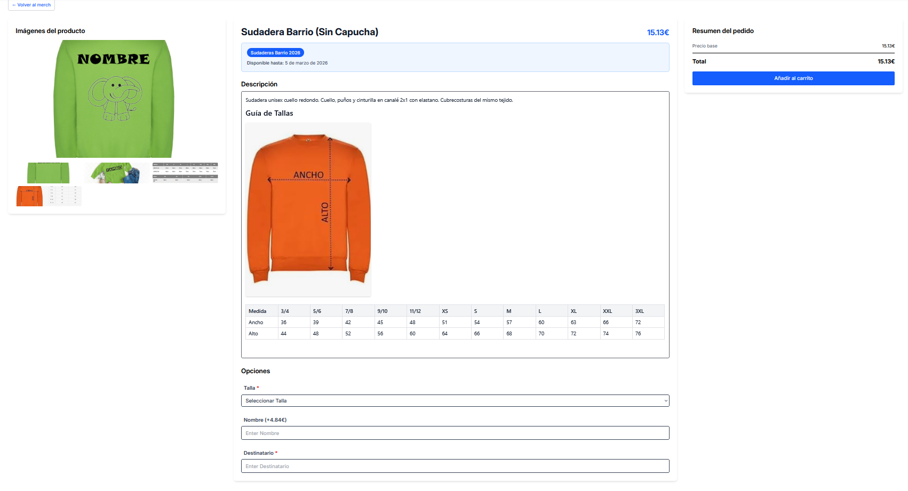

<p align="center">
  <!-- TODO: Añadir logo del proyecto -->
  
</p>

<h1 align="center">Yambo</h1>

<p align="center">
  Plataforma web comunitaria con tienda de merchandising, gestión de pedidos, incidencias e invitaciones.
</p>

<p align="center">
  
  
  
  
  
  
</p>

---
<p align="center">
  
</p>

---

## Descripción

**Yambo** es una plataforma web full-stack para una comunidad con registro por invitación. Combina un sitio público (actividades, proyectos, equipo, contacto) con un espacio privado que incluye tienda de merchandising, gestión de pedidos, seguimiento de incidencias, administración de usuarios y sistema de permisos granular basado en perfiles.

La aplicación está escrita en **español** y se despliega mediante Docker Compose o Kubernetes.

---

## Características principales

### Sitio público
- Página de inicio configurable desde el panel de administración
- Listado de **actividades** y **proyectos** con detalle
- Página del **equipo / monitores**
- Formulario de **contacto**
- Metadatos **SEO** configurables por proyecto (Open Graph, JSON-LD)

### Espacio privado (Dashboard)

| Módulo | Descripción |
|---|---|
| **Tienda** | Catálogo de productos configurables con opciones, precios y dependencias. Drops (colecciones temporales) vinculados a perfiles y proyectos |
| **Pedidos** | Flujo de estados completo (pendiente de pago → confirmado → cerrado/cancelado). Subida de justificantes. Exportación a Excel |
| **Incidencias** | Creación vinculada a productos pedidos. Comentarios con cambio de estado. Notificaciones por email |
| **Invitaciones** | Genéricas (token con ventana temporal) y nominativas (email específico, un solo uso). Asignación de perfiles |
| **Usuarios** | CRUD de usuarios, foto de perfil, biografía, asignación de múltiples perfiles |
| **Perfiles y permisos** | RBAC granular: recurso × acción (crear, leer, actualizar, eliminar, comentar). Permisos condicionales |
| **Proyectos** | Gestión de proyectos con temporadas, imágenes destacadas y agrupación de usuarios |
| **Actividades** | Estados (planificada → registro abierto → cerrada/cancelada). Fecha, responsable, visibilidad pública |
| **Ajustes** | Configuración de la app desde base de datos (email, IA, etc.) |
| **SEO** | Editor de metadatos SEO por entidad |

### Autenticación y autorización
- Registro **solo por invitación**
- Autenticación **JWT** con renovación automática
- Recuperación de contraseña por email
- Sistema **RBAC** basado en perfiles con permisos granulares

### Integraciones
- **Email**: Plantillas Thymeleaf para invitaciones, incidencias y estados de pedidos
- **IA**: Integración con Ollama para generación de texto (configurable desde ajustes)

---

## Capturas de pantalla

<table>
  <tr>
    <td align="center" width="50%">
      <br />
      <strong>Dashboard</strong>
    </td>
    <td align="center" width="50%">
      <br />
      <strong>Tienda</strong>
    </td>
  </tr>
  <tr>
    <td align="center">
      <br />
      <strong>Pedidos</strong>
    </td>
    <td align="center">
      <br />
      <strong>Incidencias</strong>
    </td>
  </tr>
  <tr>
    <td align="center">
      <br />
      <strong>Invitaciones</strong>
    </td>
    <td align="center">
      <br />
      <strong>Usuarios</strong>
    </td>
  </tr>
  <tr>
    <td align="center">
      <br />
      <strong>Proyectos</strong>
    </td>
    <td align="center">
      <br />
      <strong>Detalle de producto</strong>
    </td>
  </tr>
</table>

---

## Stack tecnológico

### Frontend

| Tecnología | Versión | Uso |
|---|---|---|
| React | 19.1 | Librería UI |
| React Router | 7.5 | Framework full-stack (SSR habilitado) |
| TypeScript | 5.8 | Tipado estático |
| Tailwind CSS | 4.1 | Estilos |
| Vite | 6.3 | Build tool |
| Node.js | 20 | Runtime (Alpine) |
| Axios | 1.9 | Cliente HTTP |
| MDX Editor | 3.52 | Editor de contenido enriquecido |
| xlsx | 0.18 | Exportación a Excel |

### Backend

| Tecnología | Versión | Uso |
|---|---|---|
| Java | 21 | Lenguaje |
| Spring Boot | 3.4.6 | Framework web |
| Spring Security | — | Autenticación y autorización |
| Spring Data JPA | — | Acceso a datos |
| PostgreSQL | 15 | Base de datos |
| Liquibase | — | Migraciones de base de datos |
| JWT (jjwt) | 0.11.5 | Tokens de autenticación |
| Thymeleaf | — | Plantillas de email |
| Lombok | — | Reducción de boilerplate |

### Infraestructura

| Tecnología | Uso |
|---|---|
| Docker / Docker Compose | Contenerización y desarrollo local |
| Nginx | Proxy inverso |
| Kubernetes | Despliegue en producción |
| Jenkins | CI/CD pipeline |
| Traefik | Ingress controller (K8s) |

---

## Arquitectura

<!-- Diagrama de arquitectura (fuente: docs/architecture.puml) -->
<p align="center">
  
</p>

### Docker Compose (desarrollo)

- **Nginx** actúa como proxy inverso: rutas `/api/*` → backend, resto → frontend SSR
- **Frontend** ejecuta Node.js (SSR) + Nginx estático dentro del mismo contenedor via supervisord
- **Backend** expone la API REST en `/api` con autenticación JWT stateless
- **PostgreSQL** almacena todos los datos con migraciones Liquibase

### Kubernetes (producción)

- Namespace: `yambo`
- Backend: 2 réplicas (256Mi–512Mi)
- Frontend: 2 réplicas (160Mi–448Mi)
- PostgreSQL: 1 réplica con PVC de 5Gi
- Ingress Traefik: `/api` → backend, `/` → frontend
- Dominio: `yambo.cabrasky.net`

---

## Requisitos previos

### Con Docker (recomendado)

- [Docker](https://docs.docker.com/get-docker/) 20+
- [Docker Compose](https://docs.docker.com/compose/) v2+

### Desarrollo local (sin Docker)

- Java 21+ (JDK)
- Node.js 20+
- PostgreSQL 15+
- Maven 3.8+ (o usar el wrapper `./mvnw` incluido)

---

## Instalación y desarrollo

### Inicio rápido con Docker Compose

```bash
# Clonar el repositorio
git clone https://github.com/cabrasky/yambo.git
cd yambo

# (Opcional) Configurar variables de entorno para email
cp .env.example .env

# Levantar todos los servicios
docker compose up -d

# La aplicación estará disponible en http://localhost
```

### Desarrollo local del Backend

```bash
cd backend

# Configurar la base de datos en src/main/resources/application.properties
# o mediante variables de entorno

# Ejecutar en modo desarrollo
./mvnw spring-boot:run

# La API estará disponible en http://localhost:8080/api
```

### Desarrollo local del Frontend

```bash
cd frontend

# Instalar dependencias
npm install

# Iniciar servidor de desarrollo con HMR
npm run dev

# La aplicación estará disponible en http://localhost:5173
```

---

## Estructura del proyecto

```
yambo/
├── backend/                 # API Spring Boot
│   ├── src/
│   │   ├── main/
│   │   │   ├── java/        # Código fuente (controllers, services, models, repos)
│   │   │   └── resources/   # Configuración, migraciones, plantillas de email
│   │   └── test/            # Tests unitarios y de integración
│   ├── Dockerfile
│   └── pom.xml
│
├── frontend/                # Aplicación React (SSR)
│   ├── app/
│   │   ├── components/      # Componentes reutilizables
│   │   ├── context/         # AuthContext, CartContext, DialogContext
│   │   ├── hooks/           # Custom hooks
│   │   ├── routes/          # Páginas y rutas
│   │   ├── services/        # Clientes API (Axios)
│   │   ├── types/           # Tipos TypeScript
│   │   └── utils/           # Utilidades
│   ├── public/              # Assets estáticos
│   ├── Dockerfile
│   └── package.json
│
├── k8s/                     # Manifiestos de Kubernetes
│   ├── backend-deployment.yaml
│   ├── frontend-deployment.yaml
│   ├── database-deployment.yaml
│   ├── ingress.yaml
│   └── secrets.yaml
│
├── docs/                    # Documentación e imágenes
│   └── images/              # Capturas de pantalla y diagramas
│
├── docker-compose.yml       # Orquestación para desarrollo
└── Jenkinsfile              # Pipeline CI/CD
```

---

## Módulos principales

### Usuarios y perfiles

El sistema de **RBAC** se basa en **perfiles** que agrupan **permisos** (recurso × acción). Un usuario puede tener múltiples perfiles. Los perfiles del sistema no se pueden eliminar.

Recursos: `user`, `profile`, `invitation`, `product`, `project`, `family_product`, `order`, `settings`, `issue`, `activity`, `seo_metadata`

Acciones: `create`, `read`, `update`, `delete`, `comment`

### Tienda y productos

Los productos tienen **opciones configurables** (tallas, colores, etc.) con dependencias entre opciones y reglas de precios. Los **drops** (`FamilyProduct`) son colecciones temporales con su propio ciclo de vida (abierto → pedidos cerrados → en fabricación → entregado).

### Pedidos

Flujo de estados:

<!-- Diagrama de flujo de pedidos (fuente: docs/order-flow.puml) -->
<p align="center">
  
</p>

Los usuarios pueden subir justificantes de pago. Los administradores pueden gestionar todos los pedidos y exportarlos a Excel.

### Incidencias

Las incidencias se vinculan a productos pedidos y siguen un flujo de estados:

<!-- Diagrama de flujo de incidencias (fuente: docs/issue-flow.puml) -->
<p align="center">
  
</p>

Cada comentario puede cambiar el estado. Se envían notificaciones por email en cada transición.

### Invitaciones

Dos tipos de invitaciones para el registro:
- **Genéricas**: Token reutilizable con ventana temporal y perfiles asignados
- **Nominativas**: Dirigidas a un email específico, un solo uso

---

## Tests

Ejecutar la suite completa de tests del backend:

```bash
cd backend
./mvnw test
```

Ejecutar tests específicos:

```bash
./mvnw test -Dtest="OrderServiceTest,OrderControllerTest"
```

---

## API

### Endpoints principales

| Método | Ruta | Descripción |
|---|---|---|
| `POST` | `/api/auth/login` | Iniciar sesión |
| `POST` | `/api/auth/register` | Registro (requiere invitación) |
| `GET` | `/api/orders` | Listar pedidos |
| `GET` | `/api/orders/my` | Mis pedidos |
| `GET` | `/api/issues` | Listar incidencias |
| `GET` | `/api/issues/my` | Mis incidencias |
| `GET` | `/api/products` | Catálogo de productos |
| `GET` | `/api/invitations` | Listar invitaciones |
| `GET` | `/api/projects` | Listar proyectos (público) |
| `GET` | `/api/activities` | Listar actividades |
| `GET` | `/api/users` | Listar usuarios |
| `GET` | `/api/profiles` | Listar perfiles |

---

## Despliegue

### Docker Compose (producción)

```bash
docker compose -f docker-compose.yml up -d --build
```

### Kubernetes

Los manifiestos se encuentran en [`k8s/`](k8s/):

```bash
kubectl apply -f k8s/namespace.yaml
kubectl apply -f k8s/secrets.yaml
kubectl apply -f k8s/database-deployment.yaml
kubectl apply -f k8s/backend-deployment.yaml
kubectl apply -f k8s/frontend-deployment.yaml
kubectl apply -f k8s/ingress.yaml
```

### CI/CD

El pipeline de Jenkins ([`Jenkinsfile`](Jenkinsfile)) automatiza:

1. **Checkout** del código
2. **Lectura de versiones** desde `package.json` y `pom.xml`
3. **Build** de imágenes Docker (multi-stage)
4. **Tests** automatizados
5. **Push** al registry privado
6. **Deploy** a Kubernetes

---

## Contribución

1. Hacer fork del repositorio
2. Crear una rama desde `develop` (`git checkout -b feature/mi-funcionalidad`)
3. Hacer commit de los cambios (`git commit -m 'Añadir nueva funcionalidad'`)
4. Push a la rama (`git push origin feature/mi-funcionalidad`)
5. Abrir un Pull Request hacia `develop`

---

## Licencia

<!-- TODO: Añadir información de licencia -->
Este proyecto es de uso privado.

---

<p align="center">
  Hecho con 💚 por <strong>Juan Cañas  y Javier Mateos</strong> para <strong>Yambo</strong>
</p>